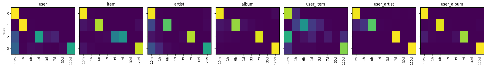
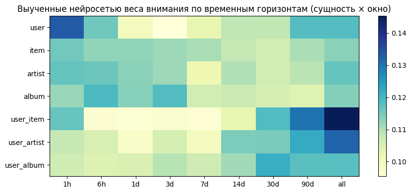

# T-Lab 2026 RecSys — Задание 1. Автоматизация построения признаков в рекомендательных системах

## 1. Постановка задачи и выбор датасета

**Датасет:** [Yambda-50M](https://huggingface.co/datasets/yandex/yambda) (Яндекс Музыка) — 10 000 пользователей с полной историей взаимодействий, 47.79M событий (`listen`, `like`, `dislike`, `unlike`, `undislike`), 934k треков, отображения `item → artist` и `item → album`, глобально упорядоченные временные метки с шагом 5 секунд и флаг источника взаимодействия `is_organic`.

**Почему Yambda-50M:**
- В отличие от KION (где взаимодействия агрегированы по дням и нет повторных просмотров одного фильма), Yambda содержит точные временные метки, пять типов событий, интенсивное повторное потребление и естественную иерархию сущностей (`track → album → artist`).
- Флаг `is_organic = 0` выделяет события, пришедшие из рекомендаций сервиса. Это даёт чистую постановку ранжирования по реальным показам без синтетического negative sampling: все модели оцениваются на одних и тех же реально показанных кандидатах.

**Целевая переменная и система метрик:**
- **Объекты выборки:** неорганические прослушивания (`event_type == "listen"` и `is_organic == 0`).
- **Таргет (`y`):** `played_ratio_pct ≥ 50` (определение *Listen+* из статьи Yambda — трек дослушан хотя бы до половины, а не пропущен).
- **Метрики:**
  1. Поточечная калибровка и разделяющая способность: `ROC-AUC` и `LogLoss`.
  2. Ранжирование внутри дня: `Day-NDCG@10` и `Day-Recall@10` по группам `(uid, day)` со смешанными исходами (2 345 групп в test).
  3. Ранжирование внутри сессии: `Sess-NDCG@10` и `Sess-Recall@10` по группам `(uid, sess_id)` (новая сессия при паузе $>30$ минут, 3 658 групп в test).
  4. **Ранжирование при фиксированном состоянии пользователя (`Snapshot-Day-NDCG@10` и `Snapshot-Sess-NDCG@10`):** все признаки пользователя `user__*` замораживаются на значении начала сессии, чтобы кандидаты ранжировались в идентичном состоянии пользователя исключительно за счёт признаков объектов (`item`, `artist`, `album`) и парных взаимодействий (`user×item`, `user×artist`, `user×album`).

---

## 2. Временное разбиение и защита от утечек данных

### 2.1. Временной сплит
Используется глобальное разбиение по времени, согласованное с официальным протоколом Yambda:
- **Test:** последний день (`[T_max − 1d + 30m, T_max]`) — 116 513 событий, 3 196 пользователей, `pos_rate = 0.715`.
- **Valid:** предпоследний день (`[T_max − 2d + 30m, T_max − 1d)`) — 109 257 событий, 3 142 пользователя, `pos_rate = 0.714`.
- **Train:** 14 предшествующих дней (`[T_max − 16d, T_max − 2d)`) — 1 443 610 событий, 7 267 пользователей, `pos_rate = 0.696`.
- **История для расчёта признаков:** все 300.9 дней до момента предсказания (point-in-time). Между сплитами оставлен 30-минутный зазор, чтобы пограничные сессии не пересекались.

### 2.2. Семантика `timestamp` в Yambda и исключение утечки через интервал времени
Проверка корреляции интервала до следующего прослушивания $\Delta t_{\text{next}} = t_{i+1} - t_i$ с длительностью проигрывания текущего и следующего треков показывает:
- $\mathrm{corr}(\Delta t_{\text{next}}, \text{played-sec}_i) = 0.353$
- $\mathrm{corr}(\Delta t_{\text{next}}, \text{played-sec}_{i+1}) = 0.578$

Это означает, что `timestamp` прослушивания фиксируется в **конце** проигрывания трека. Следовательно:
1. Признак $\Delta t_i = t_i - t_{i-1}$ («время с предыдущего события до текущего timestamp») напрямую кодирует, сколько секунд проигрывался текущий трек $i$ (короткий интервал = быстрый скип). В нашем ноутбуке это явно показано как **leak-demo**: один только запрещённый признак $t_i - t_{i-1}$ без всякой модели даёт **`AUC = 0.8542` на valid и `0.8234` на test**.
2. Чтобы полностью исключить эту утечку, а также лайки/дизлайки, поставленные во время прослушивания текущего трека, **моментом предсказания** для события $i$ назначается `ref_ts` $= t_{i-1}$ (момент завершения предыдущего прослушивания пользователя, строго $< t_i$). Все признаки рассчитываются исключительно по событиям с $\text{timestamp} \le t_{i-1}$.

---

## 3. Исследуемые подходы: единый взгляд на пространство признаков

Любой агрегатный признак над историей взаимодействий задаётся точкой в пространстве:
$$\text{Признак} = (\text{Сущность } r) \times (\text{Сигнал события } e) \times (\text{Временное окно } W) \times (\text{Агрегация } \phi)$$

Мы сравниваем ручное конструирование (в базовом и усиленном вариантах), дискретную грамматику с автоматическим отбором и непрерывные обучаемые окна:

### 3.1. Ручные бейзлайны: `H` (49 признаков) и `H-strong` (54 признака)
- **`H` (базовый ручной, 49 признаков):** стандартные календарные окна (`1d, 7d, 30d, all`) по `user`, `item` (`7d, all`), `artist` (`30d, all`), `album` (`all`), прямые связи `user×item` (`all`), косвенные связи `user×artist` (`30d, all`) и `user×album` (`all`), счётное окно `user__last10` и контекст (`track_length`, `hour_phase`).
- **`H-strong` (усиленный экспертный бейзлайн, 54 признака):** чтобы проверить, не сводится ли преимущество автоматизации только к добавлению последнего отклика пользователя, мы явно усиливаем ручной набор 5 признаками мгновенного состояния текущей сессии (`user__all__last_ratio`, `user__last3__full_rate`, `user__last3__mean_ratio`, `user__1h__full_rate`, `user__1h__mean_ratio`).

### 3.2. Подход `A` — грамматика признаков + автоматический отбор (дискретный поиск)
1. **Генерация по грамматике (`A-all`, 538 признаков):** 7 сущностей (`user`, `item`, `artist`, `album`, `user_item`, `user_artist`, `user_album`) × 9 временных окон (`1h, 6h, 1d, 3d, 7d, 14d, 30d, 90d, all`) × 8 статистик (`cnt`, `full_rate`, `mean_ratio`, `like_rate`, `n_like`, `n_dislike`, `rec_full_rate`, `org_share`) + `recency_days` и `last_ratio` для каждой сущности + окна по числу последних событий пользователя (`last3, 5, 10, 20, 50, 100`) + контекст = **538 признаков**.
2. **Масштабируемый point-in-time движок без повторных сортировок:** для каждой сущности строится таблица кумулятивных сумм флагов по времени, а сумма в любом окне $(t-W, t]$ получается разностью двух `join_asof` за $O(N \log N)$. За счёт предварительной сортировки `labels` по `ref_ts` все 63 оконных `join_asof` выполняются без промежуточных сортировок.
3. **Быстрый автоматический отбор блоков (`A-select`, 82 признака за 4.5 мин):** признаки группируются в семантические блоки `(сущность, окно)` (70 блоков), блоки ранжируются по суммарному gain в модели `A-all` на train, после чего жадный forward selection проверяет топ-32 блока (покрывающих $>99.3\%$ gain) и добавляет блок, если `valid AUC` быстрой модели (300k строк) растёт более чем на $\varepsilon = 1.2\cdot 10^{-4}$, а внутри отобранных блоков отсекаются признаки с нулевым gain. Тестовая выборка в отборе не участвует.

### 3.3. Подход `B` — экспоненциально затухающие счётчики и нейросети с обучаемыми окнами (`B-net`)
1. **Потоковые экспоненциально затухающие счётчики ([`task1_B.py`](task1_B.py) / [`t-res1-2.ipynb`](../t-res1-2.ipynb)):**
   $$D_{r,e,k}(t) = \sum_{j \in r,\ t_j \le t} x_{j,e}\, \exp\!\left(-\frac{t - t_j}{\tau_k}\right), \quad \tau_k \in \{10\text{m}, 1\text{h}, 6\text{h}, 1\text{d}, 3\text{d}, 7\text{d}, 30\text{d}, 120\text{d}\}$$
   Состояние обновляется инкрементально за $O(1)$ памяти и времени на событие ($S \leftarrow S\cdot e^{-\Delta t/\tau} + x$). Numba-скан считает 336 счётчиков по 47.8M событий за 240 с.
2. **Нейросети с обучаемыми весами временных горизонтов (`B-net` и `MultiHorizonNet`):** учат распределение внимания $\mathrm{softmax}(\alpha_{r,h})$ над временными масштабами для каждой сущности и статистики.

---

## 4. Основные результаты экспериментов (все 10 000 пользователей, Test: 116 513 рекомендаций)

### 4.1. Сводная таблица всех моделей ([`t-res1.ipynb`](../t-res1.ipynb) и [`t-res1-2.ipynb`](../t-res1-2.ipynb))

| Модель | Признаков | Valid AUC | Test AUC | Test LogLoss | Day-NDCG@10 | Day-Recall@10 | Sess-NDCG@10 | Sess-Recall@10 | Время обучения, с |
|---|---:|---:|---:|---:|---:|---:|---:|---:|---:|
| Популярность трека (`item__all__full_rate`) | 1 | 0.6466 | 0.6573 | 0.6178 | 0.7230 | 0.7814 | 0.7435 | 0.8400 | — |
| *Leak-demo (`timestamp − ref_ts`)* | *1* | *0.8542* | *0.8234* | — | — | — | — | — | — |
| **H (базовый ручной)** | 49 | 0.8941 | 0.8998 | 0.3509 | 0.7481 | 0.8138 | 0.7512 | 0.8521 | 89.1 |
| **H-strong (ручной + состояние сессии)** | 54 | 0.9066 | 0.9113 | 0.3319 | 0.7762 | 0.8388 | 0.7699 | 0.8706 | 108.0 |
| **A-select (автоотбор, 4.5 мин / 33 fits)** | **82** | 0.9077 | **0.9126** | **0.3295** | 0.7757 | **0.8426** | 0.7647 | 0.8705 | 133.5 |
| **A-all (вся грамматика без отбора)** | 538 | **0.9080** | **0.9129** | 0.3290 | 0.7764 | 0.8422 | 0.7664 | 0.8707 | 498.1 |
| **H + A-select (Binary LogLoss)** | 108 | **0.9080** | **0.9129** | **0.3289** | **0.7779** | **0.8431** | 0.7672 | 0.8713 | 189.9 |
| **LambdaRank (H + A-select, ранжирующий лосс)** | 108 | — | *0.3794*\* | *1.2567*\* | **0.8049** | 0.8321 | **0.8532** | **0.8972** | 209.6 |
| **Calibrated Ranker (0.85·Binary + 0.15·LambdaRank)** | 108 | 0.9032 | 0.9072 | 0.3705 | **0.8007** | **0.8539** | **0.7919** | **0.8798** | 209.6 |
| **B-grid → LightGBM** (сетка затуханий) | 506 | 0.9027 | 0.9070 | 0.3388 | 0.7551 | 0.8250 | — | — | 548.4 |
| **B-net (Streaming Decay Neural, GPU)** | 171 | 0.9020 | 0.9063 | 0.3406 | 0.7564 | 0.8258 | — | — | **26.8 (GPU)** |
| **B-net features → LightGBM** (дистилляция окон) | 170 | 0.9024 | 0.9068 | 0.3392 | 0.7543 | 0.8242 | — | — | 195.3 |
| **H + B-net features** | 217 | 0.9043 | 0.9085 | 0.3365 | 0.7609 | 0.8280 | — | — | 245.1 |
| **Multi-Horizon B-net (по 9 окнам грамматики, GPU)** | 538 | 0.9034 | 0.8991 | 0.3512 | 0.7695 | 0.8366 | 0.7602 | 0.8682 | **8.4 (GPU)** |
| **Hybrid (H+A-select + Multi-Horizon B-net)** | 108 | 0.9082 | 0.9120 | 0.3301 | 0.7763 | 0.8409 | 0.7654 | 0.8711 | 8.4 |

*(\*Примечание: чистый `LambdaRank` оптимизирует только относительный порядок внутри сессии и инвариантен к сдвигу константы между сессиями, поэтому не предназначен для глобального `ROC-AUC`, но даёт скачок внутрисессионного `Sess-NDCG@10` до **0.8532** и `Day-NDCG@10` до **0.8049**.)*

---

## 5. Анализ результатов: что сработало, почему и в чём ограничения

### 5.1. Сравнение не только с базовым `H`, но и с честным усиленным бейзлайном `H-strong`
- Против базового ручного набора `H` (49 признаков) автоматический отбор `A-select` (82 признака, отобранные за 4.5 минуты) даёт **+1.28 п.п. ROC-AUC (`0.8998 → 0.9126`)**, **−0.0214 LogLoss**, **+2.76 п.п. Day-NDCG@10** и **+2.88 п.п. Recall@10**.
- **Проверка против `H-strong` (54 признака):** когда мы вручную добавляем в `H` 5 главных признаков мгновенного состояния сессии (`user__all__last_ratio`, `user__last3`, `user__1h`), качество ручного бейзлайна вырастает с `0.8998` до `0.9113` AUC. Однако **автоматический поиск `A-select` (`0.9126` AUC, `0.3295` LogLoss, `0.8426` Recall@10) и `H + A-select` (`0.9129` AUC, `0.3289` LogLoss, `0.7472` Snapshot-Day-NDCG@10) всё равно уверенно превосходят `H-strong`**!
- **За счёт чего `A-select` обыгрывает даже `H-strong`:** жадный отбор автоматически нашёл мультимасштабную комбинацию из **12 блоков по всем 6 семействам сущностей**:
  - состояние пользователя: `user__all`, `user__last3`, `user__last5`, `user__last10`, `user__1h`, `user__last20`, `user__7d`, `user__90d`;
  - персональная история взаимодействий: `user_item__all`, `user_artist__90d`;
  - глобальная привлекательность объектов и контекст: `item__all`, `album__all`, `ctx`.
  По сравнению с полным `A-all` (538 признаков) `A-select` сжимает признаковое пространство в **6.6 раза**, ускоряет обучение бустинга в **3.7 раза** и сохраняет `99.97%` качества `A-all`.

### 5.2. Какие признаки и окна оказались главными (ответ на вопрос «почему 7 дней?»)
Распределение суммарного gain в модели `A-select` по сущностям и окнам:

| Сущность | Доля gain | Окно | Доля gain | Топ-5 признаков `A-select` | Доля gain |
|---|---:|---|---:|---|---:|
| `user` | **92.98%** | `all` (вкл. `last_ratio`) | 56.02% | `user__all__last_ratio` | **49.65%** |
| `user_item` | 2.82% | `last10` | 10.57% | `user__last10__mean_ratio` | **10.18%** |
| `user_artist` | 1.64% | `last3` | 10.29% | `user__last3__mean_ratio` | **9.78%** |
| `item` | 1.07% | `1h` | 5.77% | `user__1h__rec_full_rate` | 4.70% |
| `album` | 0.94% | `last5` / `90d` | 5.12% / 4.32% | `user__last5__mean_ratio` | 4.60% |
| `ctx` | 0.55% | `last20` / `7d` | 3.84% / 3.53% | `user_item__all__full_rate` | 0.28% |

- **Разные горизонты для разных сущностей:** для `user` критичны ультракороткие окна (`last3, last5, last10, 1h`) и длинная база (`7d, 90d, all`); для `user_artist` — квартальное окно `90d`; для `user_item`, `item` и `album` — полная история `all`. Никакое единое фиксированное окно («7 дней для всех») не покрывает эту структуру.

### 5.3. Строгое разрешение парадокса `ROC-AUC` vs `NDCG@10` (`Snapshot-NDCG@10` и `LambdaRank`)
В абляции на модели `H + A-select` удаление коротких окон (`≤1d, last-k`) роняет поточечный `ROC-AUC` с `0.9129` до `0.9022`, но повышает `Day-NDCG@10` с `0.7779` до `0.7937`. Мы проверили причину этого эффекта экспериментально, заморозив признаки состояния пользователя `user__*` на момент начала каждой сессии (`Snapshot-NDCG@10`):

| Модель | ROC-AUC | LogLoss | Day-NDCG@10 | Sess-NDCG@10 | **Snapshot-Day-NDCG@10** (фикс. юзер) | **Snapshot-Sess-NDCG@10** (фикс. юзер) |
|---|---:|---:|---:|---:|---:|---:|
| `H (manual, 49f)` | 0.8998 | 0.3509 | 0.7481 | 0.7512 | 0.7342 | 0.7852 |
| `H-strong (manual+session, 54f)` | 0.9113 | 0.3319 | 0.7762 | 0.7699 | 0.7408 | 0.7851 |
| `A-select (auto, 82f)` | 0.9126 | 0.3295 | 0.7757 | 0.7647 | 0.7457 | 0.7875 |
| `A-all (grammar, 538f)` | 0.9129 | 0.3290 | 0.7764 | 0.7664 | 0.7459 | 0.7854 |
| **`H + A-select (Binary LogLoss)`** | **0.9129** | **0.3289** | 0.7779 | 0.7672 | **0.7472** | **0.7887** |
| `H + A-select без коротких окон` | 0.9022 | 0.3474 | 0.7937 | 0.7930 | 0.7471 (↓) | 0.7849 (↓0.38 п.п.) |
| **`H + A-select (LambdaRank)`** | *0.3794* | *1.2567* | **0.8049** | **0.8532** | **0.7697 (+2.25 п.п.)** | 0.7812 |

**Два фундаментальных вывода из таблицы:**
1. **Как только состояние пользователя фиксируется (`Snapshot-Day-NDCG@10` и `Snapshot-Sess-NDCG@10`), парадокс полностью исчезает:** полная модель `H + A-select` (`0.7887` Snapshot-Sess-NDCG@10) **выигрывает** у модели без коротких окон (`0.7849`), а также уверенно обходит и `H` (`0.7342 → 0.7472` Snapshot-Day-NDCG@10, `+1.30 п.п.`), и `H-strong` (`0.7408 → 0.7472`, `+0.64 п.п.`). Это строго доказывает, что аномалия в обычном `Day-NDCG@10` вызвана исключительно смешением разных состояний пользователя в течение дня.
2. **Обучение со списочным лоссом `LambdaRank` (`H + A-select (LambdaRank)`) и его калиброванная комбинация (`Calibrated Ranker`)** дают кардинальный прирост ранжирования: `Snapshot-Day-NDCG@10` вырастает с `0.7472` до **`0.7697` (`+2.25 п.п.`)**, `Day-NDCG@10` — до **`0.8049`**, `Sess-NDCG@10` — до **`0.8532`**, а `Calibrated Ranker` сохраняет высокий `ROC-AUC = 0.9072` при `Day-NDCG@10 = 0.8007` и лучшем `Day-Recall@10 = 0.8539`.

### 5.4. Что выучили нейросети `B-net` и `MultiHorizonNet`
В обоих вариантах нейросетевого подхода (потоковые экспоненциальные ядра в [`t-res1-2.ipynb`](../t-res1-2.ipynb) и внимание над 9 дискретными окнами в [`t-res1.ipynb`](../t-res1.ipynb)) выученные веса окон демонстрируют одну и ту же физическую закономерность:





- Для **`user`** внимание бимодально и концентрируется на **ультракоротком горизонте `1h` (`10m–1h`)** (текущее настроение/сессия) и **долгосрочной базе `90d / all`**.
- Для парных вкусовых связей **`user_item`**, **`user_artist`**, **`user_album`** веса монотонно растут к **максимально длинным горизонтам (`30d, 90d, all`)**, так как взаимодействия с конкретным треком или артистом разрежены во времени и требуют долгой памяти.

---

## 6. Структура кода и воспроизведение

- [`task1_pipeline.py`](task1_pipeline.py) / [`task1_feature_automation.ipynb`](task1_feature_automation.ipynb) — единый полный пайплайн (EDA, проверка на утечки, point-in-time движок без лишних сортировок, `H`, `H-strong`, `A-all`, `A-select`, `H + A-select`, анализ важности, абляции, `Snapshot-NDCG@10`, `LambdaRank`, `MultiHorizonNet` и гибридный ансамбль). Выполненный Kaggle-ноутбук с полными логами на 10 000 пользователях: [`../t-res1.ipynb`](../t-res1.ipynb) (и копия [`../t-res1111.ipynb`](../t-res1111.ipynb)).
- [`task1_B.py`](task1_B.py) / [`task1_B_decay.ipynb`](task1_B_decay.ipynb) — отдельный пайплайн потокового варианта `B` ($O(1)$ Numba-скан экспоненциальных ядер, `B-grid`, `B-net` и дистилляция выученных окон в LightGBM). Выполненный Kaggle-ноутбук: [`../t-res1-2.ipynb`](../t-res1-2.ipynb).

**Запуск:**
```bash
pip install polars pyarrow lightgbm huggingface_hub scikit-learn numba torch matplotlib
python task1/task1_pipeline.py
python task1/task1_B.py
```
Для быстрого локального теста на подвыборке пользователей (с сохранением их полной истории):
```bash
SAMPLE_USERS=250 python task1/task1_pipeline.py
```
