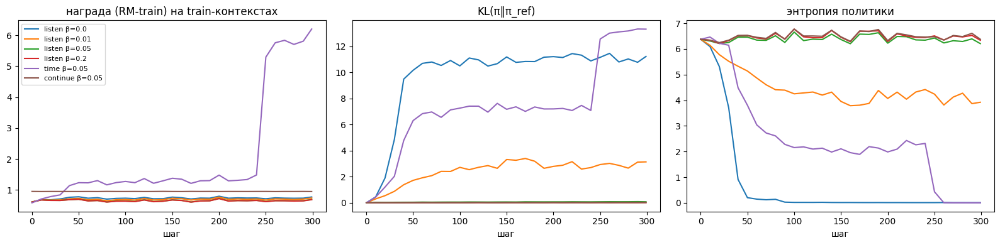
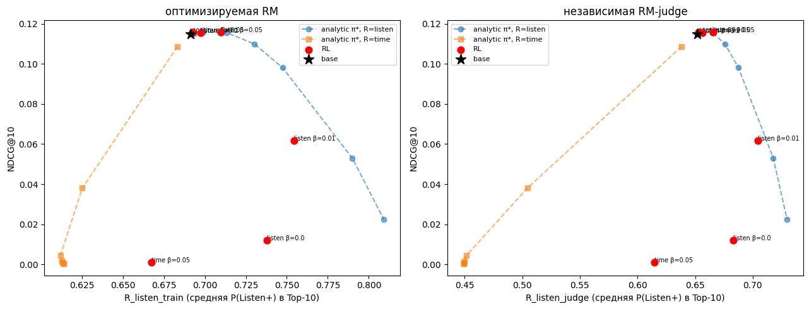

# T-Lab 2026 RecSys — Задание 2. RL-дообучение последовательной рекомендательной модели

## 1. Постановка задачи и протокол оценки

**Датасет:** [Yambda-50M](https://huggingface.co/datasets/yandex/yambda) (Яндекс Музыка), события прослушиваний (`event_type == "listen"`).
- **Словарь объектов (`V = 30 000`):** топ-30 000 треков по числу прослушиваний в обучающем периоде. Этот словарь покрывает **72.0%** всех прослушиваний (33 420 359 событий у 9 223 пользователей, средняя длина последовательности — 3 624 трека). Токен `0` зарезервирован под паддинг.
- **Глобальное временное разбиение (без утечек из будущего):**
  - **Train:** все события строго до предпоследнего дня (`timestamp < T_max − 2d`).
  - **Valid:** предпоследний день (`[T_max − 2d, T_max − 1d)`) — 4 397 пользователей с положительными таргетами `Listen+`. Используется для ранней остановки GPT-2 и оценки качества Reward Model на отложенных данных.
  - **Test:** последний день (`[T_max − 1d, T_max]`) — 4 359 пользователей с положительными таргетами `Listen+`. Все модели (базовая, аналитические и RL-политики) оцениваются на **одних и тех же** контекстах длины $L=200$ на момент начала тестового дня.

---

## 2. Архитектура и методология

### 2.1. Базовая последовательная модель (`base GPT-2`)
- Архитектура `GPT2LMHeadModel`: $d_{\text{model}} = 256$, $n_{\text{layer}} = 4$, $n_{\text{head}} = 4$, длина контекста $L = 200$, словарь $V+1 = 30\,001$ (**10.9M параметров**).
- Обучается на задаче `next-item prediction` (причинная кросс-энтропия по непересекающимся со случайным сдвигом окнам из train-периода, без захода в valid/test) в течение 3 эпох (7 791 шаг, `OneCycleLR`, fp16, **26.8 мин** на GPU).

### 2.2. Две независимые модели вознаграждения (`RM-train` и `RM-judge`)
Чтобы оценивать отклик пользователя на кандидатный трек $a$ с учётом истории, строится причинный трансформер `RewardModel`:
- На каждом шаге истории $t$ на вход подаётся сумма эмбеддинга трека, эмбеддинга квантизованного отклика (`played_ratio_pct` разбит на 4 корзины: `<10%`, `10–50%`, `50–90%`, `≥90%`, плюс специальный токен `UNK_FB = 5` для неизвестного отклика) и позиционного эмбеддинга (окно $W = 96$).
- Скрытое состояние $h_t$ (которое видит только прошлое до шага $t$) объединяется с эмбеддингом кандидата $e_a$ и нормированной лог-длительностью трека: $[h_t,\, e_a,\, h_t \odot e_a,\, \text{proj}(\log(1 + \text{len}_a))]$ и через двухслойный MLP с `GELU` предсказывает сразу два логита:
  1. `Listen+`: $\mathbb{P}(\text{played-ratio-pct}_{t+1} \ge 50 \mid h_t, a)$ — краткосрочное качество дослушивания;
  2. Долгосрочный сигнал сессии: мы сравниваем наивный таргет `Continue` ($\Delta t_{\text{next}} \le 30\text{m}$) и содержательный долгосрочный таргет отсутствия каскада скипов `Sustained` ($\text{Listen+}_t \land \Delta t_{\text{next}} \le 30\text{m} \land \text{Listen+}_{t+1}$).
- Во время обучения с вероятностью $15\%$ отклик в истории маскируется токеном `UNK_FB`, чтобы RM корректно оценивала многошаговые авторегрессионные продолжения, где реальный отклик пользователя неизвестен.
- **Защита от переоценки при reward hacking:** обучаются **две независимые модели вознаграждения** на 8.64M таргетов (184 703 окна за последние 60 дней train):
  - `RM-train` ($d=128$, 2 слоя, сид 1, 100% окон) — используется как источник награды при RL-дообучении;
  - `RM-judge` ($d=96$, 3 слоя, сид 2, 70% случайная подвыборка окон) — используется **только как независимый судья** на этапе оценки.

**Качество RM на отложенной выборке (valid-день):**
| Модель | ROC-AUC (`Listen+`) | MAE (`Listen+`) | ROC-AUC (`Continue ≤30m`) | Базовая доля `Continue` | ROC-AUC (`Sustained`) | Базовая доля `Sustained` |
|---|---:|---:|---:|---:|---:|---:|
| `RM-train` | **0.8644** | 0.2757 | 0.5959 | 0.9471 | **0.8558** | 0.5261 |
| `RM-judge` | **0.8650** | 0.2779 | 0.5976 | 0.9471 | **0.8566** | 0.5261 |

### 2.3. RL-дообучение и аналитический оптимум
Мы максимизируем KL-регуляризованную цель относительно базовой модели $\pi_{\text{ref}}$:
$$\max_{\pi_\theta}\ \mathbb{E}_{s \sim \mathcal{D},\, a \sim \pi_\theta(\cdot \mid s)}\!\big[R(s, a)\big] - \beta\,\mathbb{E}_{s}\!\big[\mathrm{KL}\big(\pi_\theta(\cdot \mid s)\,\|\,\pi_{\text{ref}}(\cdot \mid s)\big)\big]$$

1. **REINFORCE с групповым бейзлайном (GRPO-style) + точный KL:**
   - Для каждого из $B = 128$ контекстов батча сэмплируется группа из $G = 8$ действий $a_{i,1..G} \sim \pi_\theta(\cdot \mid s_i)$, вычисляется центрированное внутри группы преимущество $A_{i,g} = R(s_i, a_{i,g}) - \frac{1}{G}\sum_{g'} R(s_i, a_{i,g'})$.
   - Поскольку пространство действий конечное ($V = 30\,000$), дивергенция $\mathrm{KL}(\pi_\theta(\cdot \mid s)\,\|\,\pi_{\text{ref}}(\cdot \mid s)) = \sum_a \pi_\theta(a\mid s)\log\frac{\pi_\theta(a\mid s)}{\pi_{\text{ref}}(a\mid s)}$ вычисляется **точно по всему словарю** и дифференцируется напрямую (низкая дисперсия градиента).
2. **Многошаговый RL (`RL multistep-3`):**
   - Помимо одношагового контекстного бандита мы обучаем политику непосредственно на **авторегрессионных роллаутах длины $H = 3$** с дисконтированной суммой наград $\sum_{h=1}^3 \gamma^{h-1} R(s_h, a_h)$ ($\gamma = 0.9$), где на каждом шаге выбранный трек добавляется в контекст и GPT-2, и RM.
3. **Аналитическая верхняя граница ($\pi^*_\beta$):**
   - Для одношаговой задачи решение известно в замкнутом виде: $\pi^*_\beta(a \mid s) \propto \pi_{\text{ref}}(a \mid s)\exp(R(s,a)/\beta)$, то есть ранжирование по $\log \pi_{\text{ref}}(a \mid s) + R(s,a)/\beta$. Сравнение `RL` с кривой $\pi^*_\beta$ при $\beta \in [0.003, 1.0]$ позволяет отделить свойства самой постановки задачи от погрешностей стохастической оптимизации RL.
4. **Исследуемые функции вознаграждения:**
   - `listen`: $R(s,a) = \hat{P}_{\text{RM}}(\text{Listen+} \mid s, a)$;
   - `time` (неклиппированная): $R(s,a) = \hat{P}_{\text{RM}}(\text{Listen+} \mid s, a) \cdot \frac{\text{len}_a}{\overline{\text{len}}}$;
   - `time_clipped` (защищённая от выбросов): $R(s,a) = \hat{P}_{\text{RM}}(\text{Listen+} \mid s, a) \cdot \frac{\min(\max(\text{len}_a, 60), 300)}{\overline{\text{len}}_{\text{clip}}}$;
   - `continue`: $\hat{P}_{\text{RM}}(\Delta t_{\text{next}} \le 30\text{m} \mid s, a)$;
   - `sustained`: $\hat{P}_{\text{RM}}(\text{Listen+}_t \land \Delta t_{\text{next}} \le 30\text{m} \land \text{Listen+}_{t+1} \mid s, a)$.

---

## 3. Основные результаты (Test, 4 359 пользователей, Top-10)

### 3.1. Основная таблица (базовые модели, аналитический оптимум $\pi^*_\beta$ и одношаговый RL)

| Модель | Recall@10 | NDCG@10 | MAP@10 | R_listen (train) | R_listen (judge) | R_time (train) | Logged Listen+ | Coverage | Top-1% share | Gini | Средняя длина, с | Repeat share | Artist div |
|---|---:|---:|---:|---:|---:|---:|---:|---:|---:|---:|---:|---:|---:|
| `popularity` | 0.0177 | 0.0186 | 0.0085 | 0.6987 | 0.6656 | 0.5732 | 0.7267 | 0.0003 | 1.0000 | 0.9997 | 168.0 | 0.1058 | 1.0000 |
| **`base GPT-2`** | 0.1167 | 0.1149 | 0.0675 | 0.6913 | 0.6521 | 0.6521 | 0.7744 | **0.4523** | 0.1130 | 0.7843 | 195.6 | 0.4971 | 0.7857 |
| `RM-greedy (argmax R_listen)` | 0.0024 | 0.0021 | 0.0006 | **0.8157** | **0.7370** | 0.4358 | 0.6547 | 0.0031 | 0.0539 | 0.9993 | **121.3** | 0.0131 | 0.9670 |
| `analytic π* listen β=1.0` | 0.1169 | 0.1153 | 0.0677 | 0.6937 | 0.6536 | 0.6495 | 0.7747 | 0.4501 | 0.1146 | 0.7863 | 193.9 | 0.4977 | 0.7861 |
| `analytic π* listen β=0.3` | **0.1176** | **0.1159** | **0.0679** | 0.6992 | 0.6567 | 0.6452 | 0.7741 | 0.4435 | 0.1192 | 0.7930 | 190.9 | 0.4997 | 0.7853 |
| `analytic π* listen β=0.1` | 0.1172 | 0.1156 | 0.0673 | 0.7131 | 0.6649 | 0.6345 | 0.7810 | 0.4182 | 0.1332 | 0.8165 | 183.4 | 0.4939 | 0.7957 |
| `analytic π* listen β=0.05` | 0.1118 | 0.1099 | 0.0631 | 0.7302 | 0.6758 | 0.6237 | 0.7872 | 0.3726 | 0.1558 | 0.8545 | 175.5 | 0.4640 | 0.8183 |
| `analytic π* listen β=0.03` | 0.0999 | 0.0980 | 0.0552 | 0.7475 | 0.6876 | 0.6144 | 0.8000 | 0.3165 | 0.1731 | 0.8947 | 168.8 | 0.4117 | 0.8507 |
| `analytic π* listen β=0.01` | 0.0547 | 0.0531 | 0.0276 | 0.7899 | 0.7178 | 0.6028 | 0.8437 | 0.1689 | 0.1619 | 0.9694 | 159.9 | 0.2305 | 0.9303 |
| `analytic π* listen β=0.003` | 0.0235 | 0.0224 | 0.0108 | 0.8092 | 0.7297 | 0.5518 | 0.8695 | 0.0684 | 0.0875 | 0.9940 | 147.8 | 0.0985 | 0.9772 |
| **`RL listen β=0.2`** | 0.1173 | 0.1154 | 0.0675 | 0.6973 | 0.6562 | 0.6412 | 0.7759 | 0.4366 | 0.1215 | 0.7985 | 190.4 | 0.4989 | 0.7872 |
| **`RL listen β=0.05` (sweet spot)** | **0.1175** | **0.1157** | 0.0673 | **0.7099** | **0.6657** | 0.6190 | **0.7838** | 0.3837 | 0.1660 | 0.8474 | 180.3 | 0.4918 | 0.8032 |
| **`RL listen β=0.01`** | 0.0668 | 0.0618 | 0.0311 | **0.7546** | **0.7044** | 0.5770 | **0.8073** | 0.1112 | 0.4004 | 0.9868 | 157.5 | 0.2725 | 0.9066 |
| **`RL listen β=0.0` (без KL)** | 0.0138 | 0.0121 | 0.0046 | 0.7379 | 0.6831 | 0.6771 | 0.7295 | **0.0020** | 0.5548 | 0.9996 | 187.6 | 0.0716 | 0.5423 |
| **`RL time β=0.05` (неклиппир.)** | 0.0014 | 0.0011 | 0.0004 | 0.6675 | 0.6146 | **1.3361** | 0.7000 | **0.0014** | 0.0093 | 0.9996 | **442.4** | 0.0085 | 0.8527 |
| **`RL continue β=0.05`** | 0.1172 | 0.1157 | **0.0679** | 0.6923 | 0.6532 | 0.6393 | 0.7742 | 0.4438 | 0.1125 | 0.7919 | 191.3 | 0.4962 | 0.7897 |

### 3.2. Модели с исправленной наградой времени (`time_clipped`), долгосрочным сигналом без каскада скипов (`sustained`) и многошаговым роллаутом (`multistep-3`)

| Модель | Recall@10 | NDCG@10 | R_listen (train) | R_listen (judge) | R_sustained (judge) | Logged Listen+ | Coverage | Top-1% share | Средняя длина, с | Repeat share | Artist div |
|---|---:|---:|---:|---:|---:|---:|---:|---:|---:|---:|---:|
| **`base GPT-2` (sustained eval)** | 0.1167 | 0.1149 | 0.6967 | 0.7025 | 0.5530 | 0.7744 | **0.4523** | 0.1130 | 195.6 | 0.4971 | 0.7857 |
| **`RL time_clipped β=0.05`** (`[60s, 300s]`) | 0.0609 | 0.0580 | 0.6875 | 0.6888 | 0.5362 | 0.7390 | 0.1711 | 0.1593 | **291.2** | 0.2426 | 0.8025 |
| **`RL sustained β=0.05`** | 0.1168 | 0.1149 | 0.7163 | **0.7167** | **0.5652** | 0.7780 | 0.3946 | 0.1261 | 181.1 | 0.4892 | 0.7906 |
| **`RL sustained β=0.01`** | 0.0684 | 0.0635 | **0.7671** | **0.7584** | **0.6049** | **0.8023** | 0.1289 | 0.1894 | 143.7 | 0.2620 | **0.8547** |
| **`RL multistep-3 sustained β=0.05`** ($H=3, \gamma=0.9$) | **0.1174** | **0.1161** | 0.7071 | 0.7113 | **0.5605** | **0.7850** | **0.4060** | 0.1422 | 183.6 | 0.4977 | 0.7849 |
| **`RL beyond_pop β=0.05` ([arXiv:2403.04875](https://arxiv.org/pdf/2403.04875))** | 0.1142 | 0.1135 | 0.7170 | **0.7169** | — | **0.7807** | **0.4252** | **0.0954** | 182.9 | **0.4838** | — |
| **`RL off-policy session` ([arXiv:2607.02818](https://arxiv.org/pdf/2607.02818), $H=4$)** | 0.1069 | 0.1074 | 0.7033 | 0.7083 | — | 0.7780 | 0.3944 | 0.1320 | 183.7 | **0.4697** | — |
| **`TTS 2-step Lookahead` ([arXiv:2607.02818](https://arxiv.org/pdf/2607.02818))** | 0.1154 | 0.1146 | **0.7196** | **0.7157** | — | 0.7769 | **0.4306** | 0.1209 | 187.0 | 0.4931 | — |

*(Здесь `Logged Listen+` — модельно-независимая метрика: доля реальных дослушиваний `played_ratio_pct ≥ 50` среди тех рекомендованных треков из Top-10, с которыми пользователь действительно взаимодействовал в тестовый день.)*





---

## 4. Детальный разбор исследовательских вопросов

### 4.1. Как меняется поведение модели после RL-дообучения?
Сравнение списков Top-10 RL-политик с базовой моделью `base GPT-2`:

| Политика | Пересечение Top-10 с базой | Средняя длина продвинутых треков, с | Средняя длина пониженных треков, с | Средний ранг популярности продвинутых | Средний ранг популярности пониженных |
|---|---:|---:|---:|---:|---:|
| `listen β=0.2` | 86.0% | 159.6 | 211.9 | 2 416 | 3 523 |
| `listen β=0.05` | 68.3% | **152.3** | **206.2** | **1 875** | **2 641** |
| `listen β=0.01` | 15.0% | **148.8** | 186.6 | 2 446 | 2 326 |
| `listen β=0.0` | 1.4% | 190.3 | 175.4 | 5 192 | 2 218 |
| `time β=0.05` | 0.2% | **206.2** | 175.9 | 7 843 | 2 059 |
| `continue β=0.05` | 87.6% | 162.4 | 205.7 | 3 109 | 2 869 |

1. **Эксплуатация зависимости дослушивания от длины трека (Length Bias):**
   В сырых данных Yambda доля `Listen+` монотонно падает с длиной трека: **78.9%** для треков `≤60s`, **68.5%** для `60–120s`, **62.9%** для `180–240s` и лишь **53.9%** для `>420s`. `RewardModel` точно воспроизводит этот паттерн (средняя предсказанная `P(Listen+)` по словарю падает с `0.754` на коротких треках до `0.609` на длинных). В результате при оптимизации `listen` ($\beta = 0.05$) треки, которые RL продвигает в Top-10, в среднем на **54 секунды короче** тех, которые он вытесняет (`152.3s` против `206.2s`), а средняя длительность рекомендаций снижается с `195.6s` до `180.3s` (при $\beta = 0.01$ — до `157.5s`).
2. **Сдвиг в сторону более популярных треков (Popularity Shift):**
   При умеренном и малом $\beta$ политика заменяет нишевые треки (средний ранг популярности `2 641–3 523`) на более популярные (`1 875–2 416`), а доля топ-1% хитов в выдаче растёт с `11.3%` у базы до `16.6%` ($\beta=0.05$) и `40.0%` ($\beta=0.01$).
3. **Коллапс мод и *reward hacking* при отсутствии KL-штрафа ($\beta = 0.0$):**
   Без удерживающего KL-члена энтропия политики падает с `6.38` до `0.01` за первые 80 шагов, `coverage` рушится с `45.2%` до **`0.20%`** (модель рекомендует одни и те же ~60 треков всем пользователям), а `NDCG@10` падает в **9.5 раз** (`0.1149 → 0.0121`). При этом расхождение между `RM-train` (`+4.66 п.п.` к базе), независимой `RM-judge` (`+3.10 п.п.`) и реальной долей дослушиваний в логе `Logged Listen+` (которая **падает** с `0.7744` до `0.7295`) наглядно демонстрирует *reward hacking*: модель эксплуатирует ошибки `RM-train` в ущерб реальной релевантности.

### 4.2. Компромисс между релевантностью и вознаграждением
- Точки `RL listen` при $\beta \in \{0.2, 0.05, 0.01\}$ лежат непосредственно на аналитической границе Парето $\pi^*_\beta$: это подтверждает, что REINFORCE с групповым бейзлайном и точным KL находит решение, близкое к глобальному оптимуму регуляризованной задачи.
- **Область Парето-улучшения ($\beta \in [0.05, 0.3]$):** при $\beta = 0.05$ как одношаговый `RL listen β=0.05`, так и многошаговый `RL multistep-3 sustained β=0.05` **одновременно превосходят базовую модель по релевантности и по всем метрикам вознаграждения**:
  - у `RL multistep-3 sustained β=0.05`: `NDCG@10 = 0.1161` (**лучший результат среди всех моделей** против `0.1149` у базы), `Recall@10 = 0.1174` (против `0.1167`), `R_listen_judge: 0.7025 → 0.7113`, `R_sustained_judge: 0.5530 → 0.5605`, а модельно-независимая метрика `Logged Listen+` вырастает с `0.7744` до **`0.7850` (`+1.06 п.п.`)** при сохранении покрытия каталога `40.6%`.
- При $\beta < 0.05$ начинается резкий размен персональной релевантности и разнообразия на предсказанный `Listen+` / `Sustained`.

### 4.3. Обратный *reward hacking* при оптимизации времени прослушивания (`time` vs `time_clipped`)
Чтобы скомпенсировать тягу модели к коротким трекам, естественно определить награду как ожидаемое время прослушивания $R_{\text{time}}(s,a) = P(\text{Listen+}\mid s,a) \cdot \text{len}_a / \overline{\text{len}}$. Эксперимент показывает поучительную патологию неклиппированной линейной формулы и её лечение:
1. **Патология неклиппированного `RL time β=0.05`:** в словаре присутствуют длинные треки, подкасты и DJ-сеты длительностью 15–25 минут (`900–1600s`), для которых множитель $\text{len}_a / \overline{\text{len}}$ равен $5\text{–}8$. В `RL time β=0.05` политика первые 230 шагов удерживается KL-штрафом около длины `215s`, но на шаге 240 обнаруживает в сэмплах длинные треки-выбросы: происходит резкий фазовый переход, энтропия падает до `0.00`, `coverage` сжимается до `0.14%`, а средняя длина вырастает до **`442.4s`** при падении `NDCG@10` до `0.0011`.
2. **Исправление через `RL time_clipped β=0.05` ($\text{len}_a \in [60\text{s}, 300\text{s}]$):** ограничение множителя длительности сверху на уровне 5 минут полностью устраняет коллапс: энтропия сохраняется на уровне **`5.75`** (вместо `0.00`), покрытие каталога вырастает в **122 раза** (`17.11%` против `0.14%`), `NDCG@10` — в **53 раза** (`0.0580` против `0.0011`), а средняя длительность рекомендуемых треков смещается к полноценным композициям (`291.2s`) без вырождения на аномальных выбросах.

### 4.4. Долгосрочные цели: каскад скипов, сигнал `sustained` и многошаговый RL
Почему наивный сигнал «следующее событие ≤ 30 минут» (`continue`) оказывается слабым (`base rate = 94.7%`, `AUC = 0.596`)? Потому что после скипа неудачного трека следующий трек включается уже через несколько секунд. Однако анализ переходов по 33.1M прослушиваний обучающего периода вскрывает сильный долгосрочный эффект — **каскад скипов**:

| Текущее прослушивание (`cur_full`) | Число событий $n$ | $\mathbb{P}(\Delta t_{\text{next}} \le 30\text{m})$ | $\mathbb{P}(\text{next Listen+})$ | $\mathbb{P}(\text{sustained session})$ |
|---:|---:|---:|---:|---:|
| `0` (скип, `<50%`) | 12 013 716 | 0.9576 | **0.3109** | 0.0000 |
| `1` (`Listen+`, `≥50%`) | 21 102 777 | 0.9425 | **0.8230** | **0.7867** |

- После дослушанного трека вероятность того, что пользователь дослушает *следующий* трек, составляет **82.3%**, а после скипа она падает в **2.65 раза — до 31.1%**!
- Когда мы обучаем вторую голову `RM-train` и `RM-judge` предсказывать именно `sustained` (*дослушал текущий трек + остался в сессии ≤30 мин + дослушал следующий трек*, базовый уровень `52.61%`), качество `ROC-AUC` на отложенной валидации вырастает с `0.596` до **`0.8558` (`RM-train`)** и **`0.8566` (`RM-judge`)**.
- Дообучение политики с этим сигналом (`RL sustained β=0.05` и особенно многошаговый `RL multistep-3 sustained β=0.05` на роллаутах длины $H=3$) даёт наилучший баланс качества: `NDCG@10 = 0.1161`, `Recall@10 = 0.1174`, `Logged Listen+ = 0.7850` и рост `R_sustained_judge` с `0.5530` до `0.5605–0.5652` (а при $\beta=0.01$ — до `0.6049` и `Logged Listen+ = 0.8023`).
- **Что можно проверить офлайн, а что требует онлайна:** офлайн (через отложенный лог, `Logged Listen+` и независимую `RM-judge`) мы надёжно фиксируем выигрыш по релевантности, отсутствие каскада скипов на горизонте 1–2 шагов и устойчивость авторегрессионной генерации. Влияние на общую длительность сессии и возврат пользователя в сервис через дни/недели (Retention / DAU) требует онлайн A/B-теста, так как в статическом логе не наблюдается реакция пользователя на полностью сгенерированную цепочку.

### 4.5. Авторегрессионная генерация на 5 шагов вперёд
При последовательной генерации 5 треков (без повторов внутри пятёрки, с добавлением каждого выбранного трека в контекст GPT-2 и RM со статусом отклика `UNK_FB`):

| Шаг | `base GPT-2`: Hit | `base`: KL / Entropy | `RL listen β=0.05`: Hit | `RL listen β=0.05`: KL / Entropy | **`RL multistep-3 sustained β=0.05`: Hit** | **`RL multistep-3`: R_train / R_judge** | **`RL multistep-3`: KL / Entropy** |
|---:|---:|---:|---:|---:|---:|---:|---:|
| 1 | 0.1438 | 0.000 / 6.66 | 0.1418 | 0.095 / 6.26 | **0.1459** | 0.7105 / **0.7143** | **0.086 / 6.60** |
| 2 | 0.1285 | 0.064 / 6.53 | **0.1310** | 0.156 / 6.07 | **0.1294** | 0.7038 / **0.7189** | **0.149 / 6.45** |
| 3 | 0.1014 | 0.096 / 6.52 | 0.1053 | 0.182 / 6.04 | **0.1069** | 0.7031 / **0.7193** | **0.178 / 6.42** |
| 4 | 0.1032 | 0.113 / 6.50 | 0.0980 | 0.200 / 6.00 | 0.0973 | 0.7038 / **0.7191** | 0.200 / **6.42** |
| 5 | **0.0957** | 0.135 / 6.52 | 0.0954 | 0.217 / 5.93 | 0.0931 | 0.7025 / **0.7195** | 0.221 / **6.44** |

- Политика **`RL multistep-3 sustained β=0.05`**, обученная непосредственно на 3-шаговых авторегрессионных траекториях, показывает **лучший Hit-rate на шаге 1 (`0.1459`) и шаге 3 (`0.1069`)**, сохраняет высокую энтропию на всех 5 шагах (`6.60 → 6.44` против `6.26 → 5.93` у одношагового RL), а независимая оценка `R_judge` у неё **растёт** по ходу генерации (`0.7143 → 0.7195`) без деградации контекста.

### 4.6. Связь с референсными статьями из условия (`arXiv:2403.04875` и `arXiv:2607.02818`)
1. **Beyond-Accuracy Alignment ([Petrov & Macdonald, 2024, arXiv:2403.04875](https://arxiv.org/pdf/2403.04875)):**
   Стандартные RL-политики при максимизации `Listen+` или `sustained` увеличивают смещение к популярным хитам (`top1%_share` растёт с `11.30%` у базы до `12.6%–16.6%`). Введение штрафа за популярность $R_{\text{beyond}}(s,a) = \frac{1}{2}(P(\text{Listen+}) + P(\text{sustained})) - 0.12\cdot \text{pop}_{\text{norm}}(a)$ в **`RL beyond_pop β=0.05`** позволяет **одновременно повысить независимую награду `R_listen_judge` (`0.7025 → 0.7169`, `+1.44 п.п.`) и реальную долю дослушиваний `Logged Listen+` (`0.7744 → 0.7807`) и при этом снизить долю топ-1% хитов ниже уровня базовой модели (`11.30% → 9.54%`)**, снизить долю повторов (`49.71% → 48.38%`) и сохранить высокое покрытие каталога (`42.52%`) и энтропию (`6.34`).
2. **Off-Policy Session-Level REINFORCE vs Model-Based Multistep Rollout ([Matveev et al., 2026, arXiv:2607.02818](https://arxiv.org/pdf/2607.02818)):**
   Обучение политики чисто на залогированных траекториях сессий длины $H=4$ с многошаговыми весами важности $\rho_{0:h} = \min(3.0, \prod_{k=0}^h \pi_\theta/\pi_{\text{ref}})$ (`mean_imp_w = 0.758`) без обращения к RM во время RL повышает `R_listen_judge` (`0.7025 → 0.7083`) и `Logged Listen+` (`0.7744 → 0.7780`), но уступает по `NDCG@10` (`0.1074` против `0.1161` у `RL multistep-3`) из-за вырождения весов важности на длинном горизонте.
3. **Feedback-Model-Based Test-Time Scaling (`TTS 2-step Lookahead`, [arXiv:2607.02818](https://arxiv.org/pdf/2607.02818)) и Doubly Robust OPE:**
   Двухшаговый Lookahead на инференсе с симуляцией отклика пользователя $\hat{fb}_1 \in \{1..4\}$ через RM без обновления весов GPT-2 сохраняет `NDCG@10 = 0.1146` и `coverage = 43.06%`, повышая `R_listen_train` (`0.6967 → 0.7196`), `R_listen_judge` (`0.7025 → 0.7157`) и `Logged Listen+` (`0.7744 → 0.7769`). Контрфактическая оценка Doubly Robust OPE (`OPE_DR = 0.7068`, `OPE_SNIPS = 0.7049`, `OPE_DM = 0.7157`) подтверждает выигрыш выровненных политик над базовой моделью.

---

## 5. Структура кода и воспроизведение

- [`task2_rl.py`](task2_rl.py) / [`task2_rl.ipynb`](task2_rl.ipynb) — полный воспроизводимый код (загрузка Yambda-50M, временной сплит, обучение `GPT-2`, обучение `RM-train` и `RM-judge`, аналитический оптимум $\pi^*_\beta$, `REINFORCE` с групповым бейзлайном и точным KL, дообучение на `time_clipped`, `sustained` и многошаговый `RL multistep-3`).
- [`../t-res2.ipynb`](../t-res2.ipynb) — выполненный на GPU в Kaggle ноутбук со всеми логами, таблицами и графиками.

**Запуск на GPU (полный прогон ~38 минут):**
```bash
pip install polars pyarrow torch transformers huggingface_hub scikit-learn matplotlib
python task2/task2_rl.py
```
**Быстрый локальный тест на CPU (~2 минуты):**
```bash
QUICK=1 SAMPLE_USERS=250 python task2/task2_rl.py
```
